# Movie Ticket Booking App in Python

A desktop **movie ticket booking system** built with **Python and Tkinter**. Customers sign up, pick a movie and a theatre (INOX or PVR), choose a showtime and seats, add food and drinks, pay from a built-in **bank simulator**, and get their tickets with a QR code. Accounts are stored in **MySQL** (or MariaDB) with hashed passwords, and the bank uses **SQLite**.

**Booking flow:** sign up / log in → pick a movie → pick a theatre (INOX or PVR) → pick a showtime and seats → optionally add food and drinks → pay from a bank account → get your tickets.

## Contents

- [Features](#features)
- [Screenshots](#screenshots)
- [Setup and installation](#setup-and-installation)
- [Bank simulator and database tools](#bank-simulator-and-database-tools)
- [Running the tests](#running-the-tests)

## Features

- Sign up, log in and reset a forgotten password, with passwords stored as salted PBKDF2 hashes
- Browse movies with posters and choose between INOX and PVR theatres
- Pick a showtime and select seats on a seat map, with different seat layouts and prices per theatre
- Order food and drinks from a menu with sizes, and review everything in a cart
- Pay from a simulated bank account and receive tickets with a QR code
- Built-in bank simulator: register, deposit, withdraw, transaction history, personal info and an admin view
- Automated tests with pytest, including headless GUI walkthroughs

## Screenshots

### Account: log in, sign up and forgot password

| Log in | Sign up | Forgot password |
|---|---|---|
| 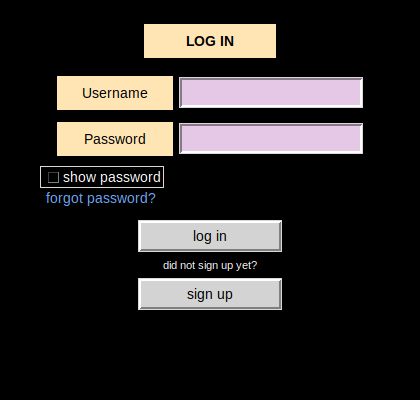 | 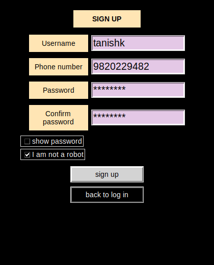 | 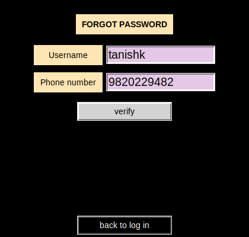 |

### Pick a movie and a theatre

| Movies | Next movie | Theatre |
|---|---|---|
| 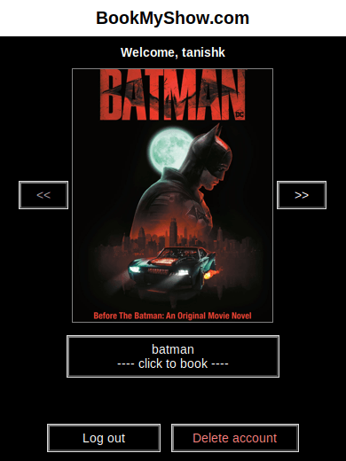 | 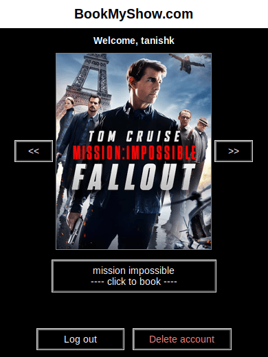 | 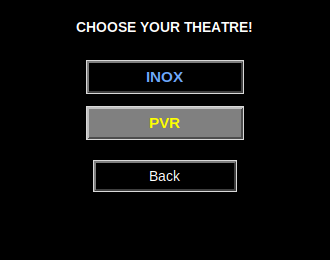 |

### Showtime and seat selection

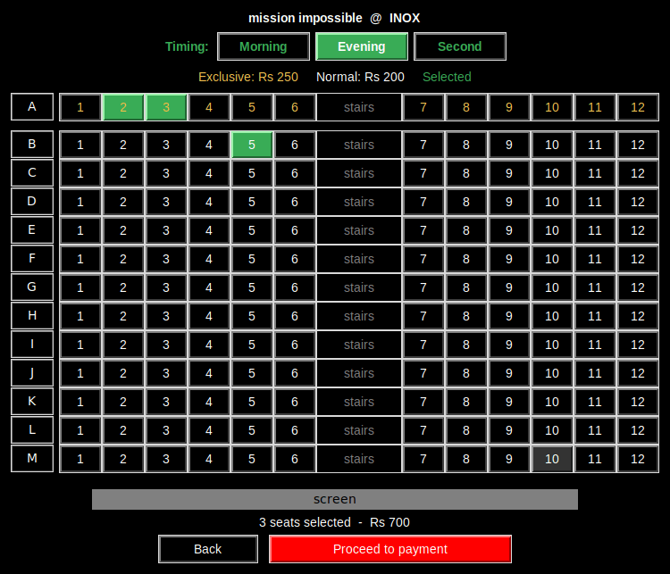

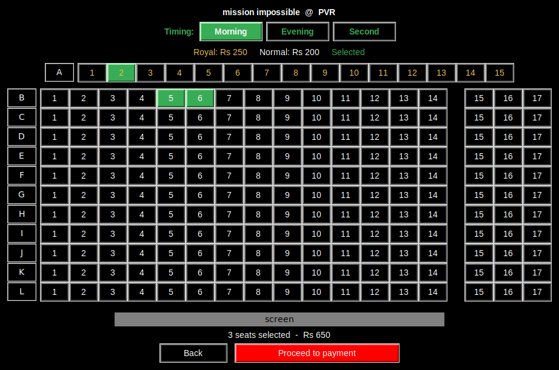

### Food and drinks

| Add on food? | Food menu | Snacks |
|---|---|---|
| 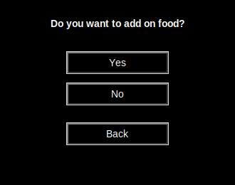 | 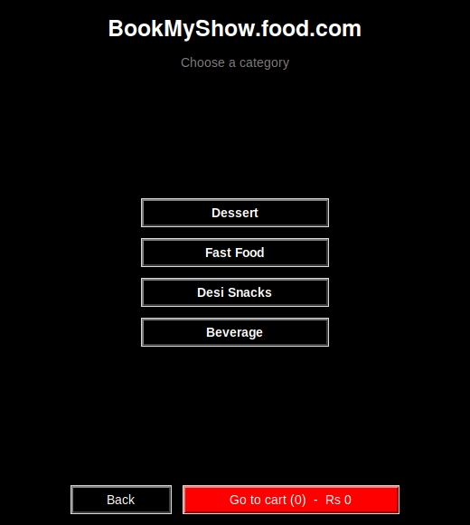 | 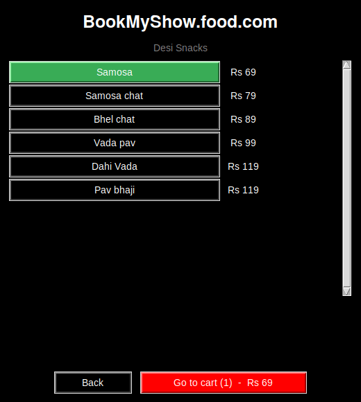 |

| Drink sizes | Cart |
|---|---|
| 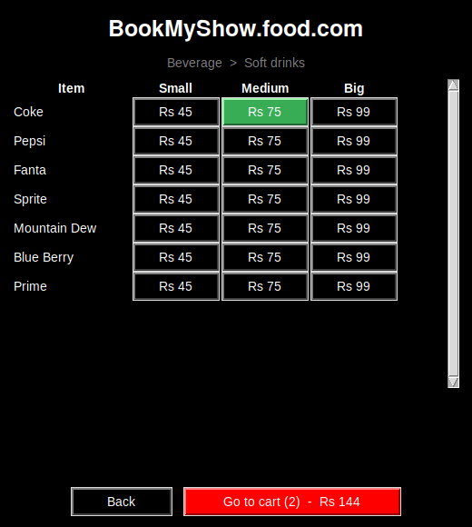 | 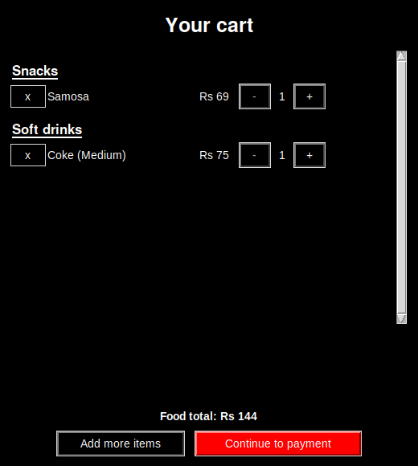 |

### Payment and tickets

| Payment | Tickets |
|---|---|
| 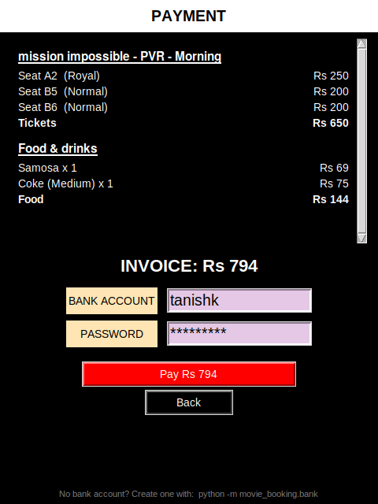 | 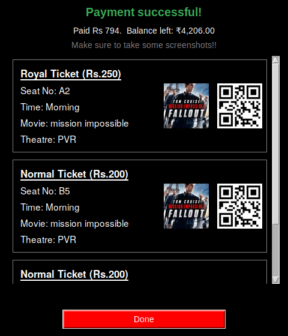 |

### Bank simulator

| Home | Register | Log in |
|---|---|---|
| 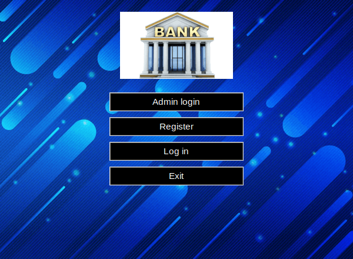 | 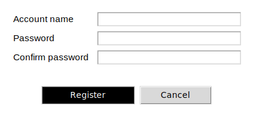 | 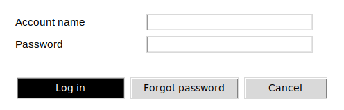 |

| Account menu | Deposit | All accounts (admin) |
|---|---|---|
| 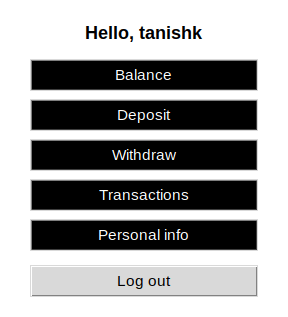 | 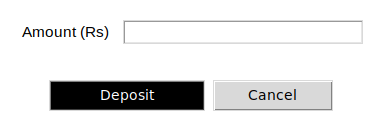 | 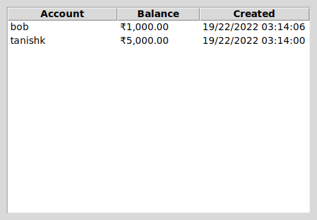 |

## Setup and installation

Requires Python 3.10+ (with Tkinter) and a running MySQL or MariaDB server.

```bash
pip install -r requirements.txt
python -m movie_booking          # or double-click login.cmd on Windows
```

On first run you are asked for your MySQL password (and whether to remember it). The database and table are created automatically.

| Setting | Environment variable | Default |
|---|---|---|
| Host | `MTB_DB_HOST` | `localhost` |
| Port | `MTB_DB_PORT` | `3306` |
| User | `MTB_DB_USER` | `root` |
| Password | `MTB_DB_PASSWORD` | *(asked at start-up)* |
| Database | `MTB_DB_NAME` | `movie_ticketbooking` |

## Bank simulator and database tools

| Command | What it does |
|---|---|
| `python -m movie_booking.bank` | Bank simulator: register, deposit, withdraw, history, personal info, admin view |
| `python -m movie_booking.dbtool` | MySQL maintenance menu (create/drop database and table, insert demo users) |
| `python -m movie_booking.bank` | Import accounts from the old file-based bank |

You need a bank account to pay for a booking: register one in the bank app and deposit some money first.

## Running the tests

```bash
pip install -r requirements-dev.txt
pytest                      # logic tests; GUI tests are skipped without a display
xvfb-run -a pytest          # include the GUI tests on a headless Linux box
```